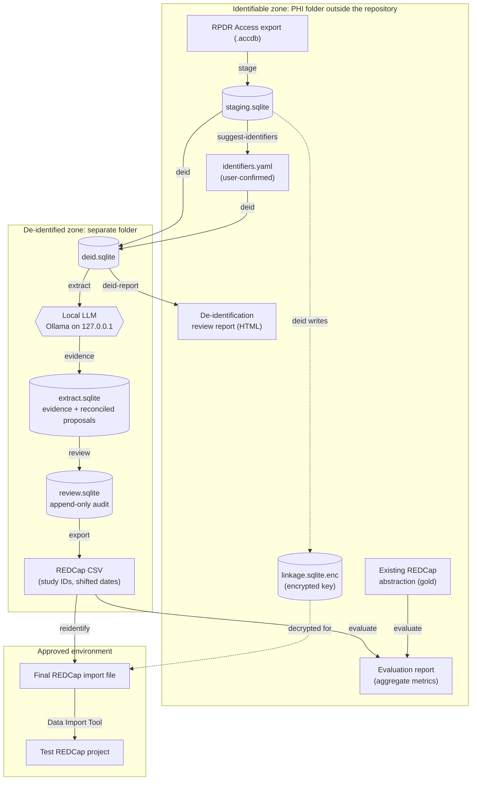
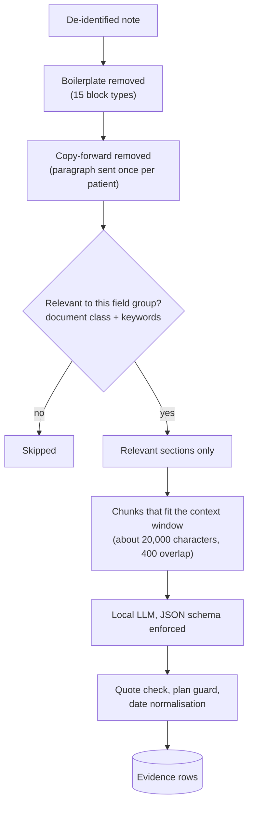

# NMOSD Extractor: Project Overview

**Local, privacy-preserving extraction of NMOSD registry data from clinical notes, with clinician review of every value**

| Item | Detail |
|---|---|
| Document date | 10 November 2026 |
| Software version | 0.1.0 |
| Status | All nine build phases are implemented and pass their tests on synthetic data. The real-data pilot has not started. |
| Registry | Mass General Brigham (MGB) *NMOSD database*, REDCap project PID 47765 |
| Related documents | `README.md`, `BUILD_PLAN.md`, `docs/RUNBOOK.md`, `docs/date_shifting.md`, `TODO.md` |

---

## 1. Summary

NMOSD Extractor is a software pipeline that helps fill in the MGB NMOSD research registry (REDCap PID 47765) from the free-text clinical notes in a Research Patient Data Registry (RPDR) export. It works in five moves:

1. It **de-identifies** the notes: names, record numbers, addresses and other identifiers are replaced with neutral tokens, and every date is shifted by a random per-patient offset.
2. A **large language model (LLM) running on the local machine** reads the de-identified notes and pulls out evidence for each registry field, with a verbatim quote for every item.
3. **Rules reconcile** the evidence into proposed REDCap records: one record per relapse, per treatment course and per antibody test.
4. A **clinician reviews every proposed value** in a local web app, with the source passage highlighted, and accepts, corrects or flags it.
5. Only reviewed values are **exported** as a REDCap import file. They are mapped back to real patients and real dates only in an approved environment.

The pilot covers **5 patients** and about **20 registry fields** across four REDCap instruments: Demographics (diagnosis), Relapse, Treatment and Antibody Lab Data. Everything runs offline on a Windows 11 laptop with no GPU. At runtime the software makes one kind of network connection only: to the local Ollama model server on `127.0.0.1`.

Three ideas shape the whole design:

- **Patient data never leaves the machine**, and the model only ever sees de-identified text.
- **The model proposes and a clinician decides.** No value reaches REDCap without a human action, recorded in an append-only audit log.
- **Every value carries its evidence**: a verbatim quote, checked against the note, with character positions so the reviewer sees it highlighted in context.

| Key fact | Value |
|---|---|
| Source data | RPDR Microsoft Access export: 32 patients, 1,526 note rows across six note tables, plus a Demographics table |
| Pilot scope | 5 patients, 4 instruments, about 20 core fields (29 including date-estimate and structured fields) |
| Model | Local LLM served by Ollama; default `qwen3:8b`, with `gemma3:12b` under evaluation |
| De-identification | Rule layers, two clinical de-identification transformer models, precision-aware date shifting, an automated leak test and 100% human review |
| Human review | Every de-identified document and every proposed value |
| Output | REDCap flat import CSV, imported first into the test project |
| Testing | 226 automated tests pass on synthetic data; 7 are skipped until the real REDCap dictionary and a local Ollama server are available |

---

## 2. Background

### 2.1 The clinical question

Neuromyelitis optica spectrum disorder (NMOSD) is a rare, relapsing autoimmune disease of the central nervous system. Most patients have antibodies against aquaporin-4 (AQP4-IgG). The registry also tracks MOG antibody-associated disease (MOGAD), which can look similar. Attacks typically cause optic neuritis, transverse myelitis (often longitudinally extensive, LETM), area postrema syndrome (intractable hiccups, nausea and vomiting) or brainstem syndromes. Attacks can leave lasting disability, so long-term preventive immunotherapy is central to care: rituximab, inebilizumab, eculizumab, ravulizumab, satralizumab, azathioprine, mycophenolate and others.

For each patient the registry records:

- when NMOSD was diagnosed and what the patient was thought to have before;
- every attack, with its onset date, clinical phenotype, whether the patient was admitted, the acute treatment and the MRI findings;
- every course of maintenance therapy, with start and stop dates and the reason for stopping;
- antibody test dates and results.

### 2.2 Why manual abstraction is hard

Today, filling these fields means a clinician or research assistant reading years of notes. In this cohort that is hard for specific, measurable reasons. All the figures below come from metadata-only profiling of the real export (counts and lengths, never text).

- **Volume.** About 4.6 million tokens across the 32 patients: a median of about 107,000 tokens per patient and up to about 577,000. Visit notes have a median length of about 27,000 characters and reach 101,000.
- **Repetition.** Clinic letters copy text forward. In visit notes, a median of 33% (IQR 0 to 62%) of each note's longer paragraphs already appeared in an earlier note for the same patient. The same relapse is retold in many letters, sometimes with slightly different dates.
- **Vague and inconsistent dates.** "Summer 2016", "3/19", "March '19". The registry needs both a date and an *estimate code* that says how precise the date is.
- **Plans versus events.** "Plan to start rituximab" or "prior authorization submitted" is not a start date, but it reads like one.
- **Evidence in the narrative only.** This export has no medication or laboratory tables, so treatments, antibody results and B-cell counts have to come from note text.
- **Boilerplate.** Vitals tables, immunisation lists, billing lines and document-index blocks pad many notes.

### 2.3 Why a local LLM, and why these safeguards

LLMs are good at reading long clinical narrative. They can recognise that "a second attack of myelitis in spring 2018, treated with IVMP and PLEX" describes a relapse with a phenotype, an approximate date and two acute treatments. Three constraints shape how one can be used here:

1. **The notes contain protected health information (PHI).** Cloud services are ruled out for this pilot, so the model runs on the local machine and only sees de-identified text.
2. **LLMs can invent facts or mistake plans for events.** Every output must be tied to a quote that is checked against the note, and a clinician reviews every value.
3. **The pilot laptop has no GPU.** Inference runs on the CPU and is slow, so the text sent to the model has to be cut down hard before inference.

---

## 3. Aims and scope

### 3.1 Aim

To build and pilot a pipeline that proposes REDCap registry values for NMOSD patients from their clinical notes, safely and with traceable evidence, and to measure how well it agrees with existing manual abstraction and how much clinician time the review takes.

### 3.2 Objectives

1. **De-identify** the pilot patients' notes with zero known-identifier leaks and a documented 100% human review.
2. **Extract evidence** for each pilot field with a local LLM, with every item tied to a verified verbatim quote.
3. **Reconcile** repeated mentions into REDCap-shaped records: one instance per relapse, treatment course and antibody test.
4. **Support clinician review** of every proposed value, with the source passage on screen and a full audit trail.
5. **Export** a REDCap import file that passes validation, and re-identify it exactly in an approved environment.
6. **Evaluate** the results against the existing REDCap abstraction for the same patients: field accuracy, episode matching, date error and review time, and compare the candidate models.

### 3.3 Definition of done for the pilot

One complete path works on the 5 real pilot patients:

- de-identified with zero leak-test hits and a human sign-off;
- extracted overnight on the pilot laptop;
- reviewed in the app;
- exported, then re-identified in the approved environment;
- imported into the **test** REDCap project;
- evaluated against the existing abstraction.

### 3.4 Out of scope for the pilot

- Imports into the production REDCap project. The pilot imports into the test project, through the Data Import Tool; the REDCap API comes later.
- Instruments and fields beyond the pilot set.
- Any cloud model or remote service.
- Letting the model decide which patient a document belongs to. That is fixed upstream by the RPDR patient identifier (EMPI).
- Letting the model fill identifier fields (`mrn`, `dob`) or calculated fields. Identifier fields are filled only at re-identification; calculated fields are never filled.
- Accepting any value automatically.

---

## 4. Design principles

| Principle | What it means in practice |
|---|---|
| Local only | The only runtime network call goes to Ollama on `127.0.0.1`. Model names containing "cloud" are refused, models must be on an allow-list, and the Hugging Face libraries are forced offline. |
| De-identify first | The LLM reads only de-identified text. The de-identification is checked by an automated leak test and a 100% human review before extraction starts. |
| Human in the loop | The model proposes and a clinician accepts or corrects. Only accepted or corrected values are exported. |
| Evidence for every value | Each proposed value links to the quotes that support it, located in the note by character offsets. |
| Codes, not labels | REDCap choices are matched by their code, never by label text or list position. The codebook has duplicate labels and out-of-order codes, so anything else would silently mis-code values. |
| Rules in configuration | Field definitions, section headings, boilerplate, document types, de-identification patterns and allow-lists live in editable YAML files, so clinicians can change rules without touching code. |
| Counts only on screen | Every command that touches real data prints counts, timings and metrics only: never note text, IDs, names or dates. |
| Reproducible and resumable | Fixed seed, temperature 0, pinned model revisions, hashed prompts and rule files. Long runs save after every document and resume where they stopped. |
| Swappable parts | Small interfaces for the LLM client, the NER models and the Access reader, so Snowflake Cortex, AnonCAT or another database driver can be added later without rewriting the pipeline. |

---

## 5. Source data

### 5.1 The RPDR export

The source is a Microsoft Access database (`.accdb`, about 48 MB) from the MGB RPDR, covering 32 patients. Its schema was confirmed by a metadata-only inspection on 9 November 2026.

| Table | Rows | Patients | Content |
|---|---|---|---|
| Demographics | 32 | 32 | Sex, date of birth, age, race, ethnicity, language, vital status, ZIP. No names or MRNs. |
| VisitNote | 432 | 32 | Office, telemedicine and ED notes, patient emails, MyChart renewals. Median about 27,000 characters. |
| ProgressNote | 870 | 32 | Progress, nursing, lactation and perioperative notes. Median about 4,500 characters. |
| Radiology | 164 | 23 | Only 116 distinct texts (the same report appears under several numbers). About 70 are neuro MRI reports. |
| Pathology | 37 | 18 | Mostly irrelevant; 7 flow cytometry reports may give CD19/CD20 counts. |
| Discharge_Summaries | 12 | 9 | Median about 34,000 characters. |
| HistoryAndPhysical | 11 | 8 | Admission notes. |

Every note table has the same seven columns: `EMPI`, `Report_Number`, `Report_Date_Time`, `Report_Description`, `Report_Status`, `Report_Type` and `Report_Text`.

Quirks the code handles:

- Every note ends with a `[report_end]` marker, which is stripped.
- Dates are stored as text in two formats: two-digit years (`mm/dd/yy hh:mm:ss`) in visit, progress and H&P notes, and four-digit years with AM/PM elsewhere.
- Date of birth has a two-digit year; the century is resolved from the `Age` column, and mismatches are flagged.
- `Report_Status` is F (final), P (preliminary) or R (revised). F and R are kept; P is dropped when a final version of the same report exists.
- The first letter of `Report_Type` encodes the hospital site (B, M, F, W, N, S, V) and is kept as a `site` column.

**Not in this export:** the `Med`, `Lab`, `Lno`, `Mrn`, `Con` and `Enc` tables. Medications, antibody results and B-cell counts therefore come from note text. The staging step copies any extra table that has an EMPI column, so if RPDR supplies these tables later they flow through without code changes.

### 5.2 Inside the notes

The following features of the real notes were learnt from profiling scripts that print only counts and masked shapes (for example `<NN> <Years> <Sex?> MRN: <digits>`), never note text. The same shapes drive the synthetic data used for development and testing.

- **Header blocks.** Most notes start with identifying lines: a confidentiality banner, the patient's name, MRN, date of birth, town, ZIP and account number. They follow a handful of fixed layouts per table.
- **Consistent section headings** across patients: HPI, Interval Events, Medications, Exam, Data/Results, Assessment & Plan; FINDINGS and IMPRESSION in radiology. Neuroimmunology notes carry `Dx:` and `Tx:` summary lines that list diagnosis and treatment history, which are especially valuable for extraction.
- **Boilerplate** blocks, listed in Section 7.6.
- **Copy-forward** paragraphs, as quantified in Section 2.2.
- **Values that look like dates but are not**: visual acuity `20/20`, strength `5/5`, blood pressure `120/80`, titres `1:100`, spinal levels `C2-C5`, doses `1/2 tab`.

Keyword prevalence across the 32 patients:

| Term | Patients | Term | Patients |
|---|---|---|---|
| NMO / NMOSD terms | 32 | satralizumab | 10 |
| AQP4 | 30 | mycophenolate | 10 |
| inebilizumab | 25 | azathioprine | 5 |
| IgG | 24 | tocilizumab | 2 |
| rituximab | 19 | CD19 / CD20 | 14 |
| eculizumab / ravulizumab | 18 | pregnancy | about 13 |
| MOG | 16 | EDSS / mRS | 9 (rarely documented) |

---

## 6. How it works: the pipeline at a glance

Each step is a command, run as `python -m nmosd <command>`. Paths default to the values in `config/settings.yaml`, which is git-ignored and points to the PHI folder outside the repository. The diagram shows where each file lives.

| # | Step | Command | Input to output | Run by |
|---|---|---|---|---|
| 1 | Inspect the source | `inspect` | Access export to a metadata summary on screen | User |
| 2 | Benchmark models | `benchmark` | Synthetic notes to a speed table | User, on the pilot laptop |
| 3 | Stage | `stage` | Access export to `staging.sqlite` | User |
| 4 | Choose the pilot patients | `select-pilot` | Staging DB to a per-patient volume table | User |
| 5 | Confirm identifiers | `suggest-identifiers` | Staging DB to a candidate list, which the user checks and saves as `identifiers.yaml` | User |
| 6 | De-identify | `deid` | Staging DB and identifiers to `deid.sqlite` plus the encrypted linkage key | User |
| 7 | Check the de-identification | `leak-test`, `deid-report`, `deid-signoff` | Leak counts, a side-by-side HTML report and a recorded sign-off | User and reviewer |
| 8 | Build schemas | `schemas` | REDCap data dictionary to JSON schemas | User |
| 9 | Extract evidence | `extract` | De-identified notes to evidence rows | User, overnight |
| 10 | Reconcile | `reconcile` | Evidence to proposed REDCap records | User |
| 11 | Review | `review` | Proposals to reviewed values (audit log) | Clinician |
| 12 | Export | `export` | Reviewed values to a REDCap CSV in study-ID space | User |
| 13 | Re-identify | `reidentify` | Export, linkage key and record map to the final import file | User, approved environment |
| 14 | Evaluate | `evaluate` | Export and existing REDCap records to an aggregate report | User |

Step-by-step instructions for real data, including which outputs are safe to share, are in `docs/RUNBOOK.md`.

---

## 7. Stage by stage

### 7.1 Inspecting the source and benchmarking models

**`inspect`** reads the Access export through one `AccessReader` interface with three backends: `pyodbc` with the Microsoft Access Database Engine driver (Windows), `mdbtools` (macOS and Linux), and SQLite (synthetic data). It prints table and column names, types, row counts, distinct counts and text-length distributions (minimum, median, 95th percentile, maximum), including the longest memo field so truncation can be spotted. Counts of note titles appear only with `--show-categories`, which prints a warning first.

**`benchmark`** runs each candidate model on synthetic notes of about 500, 2,000 and 6,000 tokens. It reports prompt-processing and generation speed (tokens per second), wall time, model load time, peak RAM of the Ollama processes, whether the structured output validated, and any truncation warnings. The results decide the default model and show how long an overnight run will take.

### 7.2 Staging

**`stage`** copies only the pilot patients' rows into a staging SQLite database in the PHI folder. The pilot EMPIs come from a list file that is also in the PHI folder.

- All note tables are merged into one `documents` table. Text is kept byte-for-byte apart from the `[report_end]` marker.
- The status policy above is applied (keep final and revised versions; drop preliminary versions that have a final).
- Exact duplicate texts within a patient collapse into one document. Every source report number is kept in a `document_sources` table, which handles the radiology reports filed under several numbers.
- Each document gets a **relevance class** from `config/doc_types.yaml`: `neuro_mri`, `clinical_note`, `patient_message`, `flow_cytometry`, `pregnancy_related` or `low_value`. It also gets its site letter.
- Both date formats are parsed, and the date-of-birth century is resolved from age.
- Any extra structured table with an EMPI column is copied as-is.

The command prints counts only.

### 7.3 Choosing the pilot patients

Running `stage --all-patients` and then **`select-pilot`** builds a per-patient table in the PHI folder showing:

- estimated tokens before and after filtering;
- note counts by type;
- the number of neuro MRIs;
- keyword flags (AQP4, MOG, each drug, pregnancy, CD19).

The screen shows only aggregate distributions. The user opens the table, picks 5 varied patients of moderate volume, and writes their EMPIs to the pilot list.

### 7.4 De-identification

This is the most safety-critical step. Its goal is to remove every identifier while keeping the clinical meaning, including the timeline.

#### Layers, in order

Each document goes through these layers in sequence:

1. **Header block.** The note's header is parsed with configurable patterns (`config/deid/patterns.yaml`), and the identifiers in it are harvested for the next layer. For visit, progress, H&P and discharge notes the whole block is replaced by a neutral header, `[NOTE_TYPE] [SITE] [SHIFTED_DATE]`. Radiology and pathology headers carry clinical content (exam title, indication, specimen), so they stay in place and are cleaned by the later layers. Headers that match no known layout are flagged for review, and the match rate per table is reported.
2. **Known identifiers.** For each patient this layer uses the user-confirmed `identifiers.yaml`, the identifiers harvested from headers, the date of birth and ZIP from Demographics, and the `Mrn`/`Con` tables if they are ever supplied. Staff names are harvested from headers and sign-offs. The layer generates variants of each identifier:
    - name orderings, initials with surname, and possessives;
    - MRNs with and without separators;
    - the date of birth in every format;
    - phone formats, address pieces, ZIP and email;
    - relatives' names.

    Matching ignores case and whitespace. The exception is single names that are also ordinary English words (a relative called "Hope", a town called "Reading"), which match only in Title or UPPER case.
3. **Pattern layer.** Regular expressions catch phone numbers, email addresses, URLs, Social Security numbers, MRN-like digit runs (7 to 10 digits, configurable), accession numbers, ZIP codes and ages of 90 or over. Contextual rules catch clinician names after phrases such as "Electronically signed by" or "Dictated by", relatives after "her husband", titled names, and hospitals and organisations.
4. **NER ensemble.** Two clinical de-identification transformer models run locally on the CPU: the OBI model `obi/deid_roberta_i2b2` and the Stanford AIMI model `StanfordAIMI/stanford-deidentifier-v2`. Fallback models are configured, and every model is pinned to a commit hash. Each note is read in overlapping windows (1,800 characters, with 300 characters of overlap). The pipeline takes the **union** of both models' detections at a low threshold (0.30): if either model flags a span, it is treated as PHI. This deliberately favours recall over precision. The models' labels are mapped to one scheme: PATIENT, STAFF, RELATIVE, AGE, DATE, PHONE, ID, EMAIL, URL, LOCATION, HOSPITAL and ORGANIZATION. Spans labelled DATE go to the date shifter rather than being redacted. Per-model and union counts are recorded, so the reviewer can see where the models disagree. The build plan's first choice, an OBI model trained partly on MGB notes (`obi/deberta_deid_i2b2_mgb`), is not available on the Hugging Face Hub, so the i2b2-trained RoBERTa model is used instead.
5. **Allow-list.** Drug names, eponyms (Devic, Babinski, Lhermitte, Uhthoff, Romberg), assay names, NMOSD terms, anatomy and US states are never removed by the pattern or NER layers (`config/deid/allowlist.yaml`). Each override is counted. If a confirmed identifier happens to match an allow-listed term, it is still removed, and the document is flagged.
6. **Date shifting** (details below).
7. **Surrogate tokens.** Overlapping detections are merged, with known identifiers taking priority over patterns and patterns over NER. Each is replaced with a token that stays consistent within a patient: `[PATIENT]`, `[CLINICIAN_01]`, `[RELATIVE_01]`, `[HOSPITAL_01]`, `[TOWN_01]`, `[ID]`, `[PHONE]`, `[EMAIL]`, `[ADDRESS]`, `[ZIP]`. The same clinician gets the same number in every note, so the model can still follow "[CLINICIAN_02] recommended starting rituximab". Whether hospital names are tokenised or kept is a setting, pending a decision by the principal investigator (PI).

#### Date shifting

- Each patient gets one random offset, drawn uniformly from ±30 to ±365 days (never zero). It is stored only in the encrypted linkage key.
- Every date for that patient moves by the same offset, so **intervals are preserved**: time from onset to treatment, time between relapses, and so on.
- Shifting is **precision-aware**, and the written format is kept:

| Written in the note | Shifted by | Example with a +200-day offset |
|---|---|---|
| Full date (`3/4/2019`, `2019-03-04`, `March 4, 2019`) | days | `9/20/2019` |
| Full date with weekday | days; weekday recomputed | `Monday, March 4, 2019` to `Friday, September 20, 2019` |
| Month and year (`March 2019`, `9/2016`, `March '19`) | whole months | `October 2019`, `4/2017` |
| Year only (`in 2016`, `(2011)`) | whole years | `in 2017` |
| Season (`summer 2016`) | label by months, year by years | `winter 2017` |
| Ambiguous short form (`3/19`) | month shifted, any year carry applied, and flagged | `10/19` |

- Shifting each precision by whole units of its own size means **re-identification is exact**. A month-precision date shifted by days would land on a different month after un-shifting about half the time.
- Values that look like dates are never shifted: visual acuity, strength grades, blood pressure, reflexes, doses, titres, spinal levels, numeric ranges and scores. Each has its own rule and unit tests.
- Holidays ("Christmas") become `[HOLIDAY]`, and relative anchors ("birthday") are flagged for review.
- Ages of 90 and over become `90+`.

The full rule set is in `docs/date_shifting.md`.

#### Identifiers, structured data and the linkage key

- **Study and document IDs** are cryptographically random: `NMO-` plus 6 characters for patients and `DOC-` plus 10 for documents. They use an alphabet without look-alike characters (no 0/O, 1/I/L and so on) and bear no relation to source IDs. Source report numbers are dropped. Re-runs reuse the same IDs and offsets through the linkage key.
- **Structured tables**: identifier columns are dropped, dates are shifted, and free text goes through the same layers. The de-identified `patients` table keeps only sex, race, ethnicity, language group, vital status, a shifted date of death and an age capped at `90+`.
- **The linkage key** is a single encrypted file. It maps each study ID to the EMPI and MRNs and holds the date of birth, the date offset, the token-to-original maps and every replacement span. It is encrypted with Fernet (AES-128 with HMAC-SHA256 authentication), using a key derived from a passphrase by scrypt. The passphrase must be at least 12 characters and comes from an environment variable or a prompt. The code refuses to write the key in the same folder as the de-identified output, or in a folder nested inside it or containing it. **If the passphrase is lost, the data can never be re-identified.**
- **It fails closed.** `deid` refuses to run without a confirmed `identifiers.yaml` (unless an explicit dry-run flag is given) and refuses to run without the NER layer (`--no-ner` exists for testing only).

#### Checks before anything is extracted

- **`leak-test`** re-scans every de-identified document for every variant of every patient's identifiers, including other patients' identifiers, plus staff and organisation names. The count must be zero; otherwise the command exits with an error. It also counts residual pattern and NER candidates by category for the reviewer.
- **`deid-report`** writes a local HTML report to the PHI folder. It shows the original and de-identified text side by side with every replacement highlighted. Each document has a "reviewed: no residual PHI" checkbox and a box to note misses (by location, never by value). The reviewer's ticks are exported as a sign-off file.
- **`deid-signoff`** imports that file into the run's **manifest**. The manifest also records the tool, Python, transformers and torch versions, a hash of the rule files, the NER models and their revisions, replacement counts by category, per-model NER counts, review flags and header-match rates.

### 7.5 From the REDCap codebook to machine-checkable schemas

**The data dictionary.** REDCap's data dictionary CSV holds metadata only, with no PHI. The parser reads field names, forms, types, choices (keyed by code), validation rules, branching logic and annotations. It detects calculated, descriptive and `@HIDDEN` fields, and it handles the codebook's quirks:

- `type_test` uses text codes (`aqp4`, `mog`);
- `rx_before_nmo` lists Methotrexate under two codes (5 and 11);
- `adverse_events` lists code 6 before code 5.

Until the real dictionary CSV is supplied, the code uses a transcription of the codebook for the four pilot instruments (`tests/fixtures/redcap/data_dictionary_pilot.csv`).

**Field specifications.** `config/fields/pilot_fields.yaml` gives each pilot field:

- a definition;
- acceptable evidence;
- exclusions;
- a time window;
- an ambiguity rule;
- its estimate field;
- prefilter keywords;
- a preferred source (structured data or notes);
- a status.

For example, `date_starting_maint` is defined as the date a drug was first actually given; its exclusions are "plan to start", "will start", "prior authorization submitted" and prescription dates. Every spec was drafted from the codebook and is marked **"draft: needs clinician sign-off"** until a clinician approves it.

**Schemas.** For each field group, a Pydantic model is generated and converted to a JSON schema, which is passed to Ollama so the model can only return valid JSON of the right shape. Coded fields allow only the REDCap codes plus `UNK` and `not_established`. Checkbox fields are lists of codes. Dates are `YYYY-MM-DD` with a separate estimate code.

**Structured fields.** Sex, race, ethnicity and living/deceased status are mapped directly from Demographics through `config/redcap/structured_maps.yaml`, and that mapped value is the proposal. The `demographics` field group also has the LLM search the notes for sex, race and living/deceased (ethnicity is taken from the table only). Each field's own note mentions are its evidence in review. A note that disagrees with the structured value is flagged as a conflict, and a value with no note mention is marked as having no note evidence. When the map does not cover the structured value, the most frequent note value is proposed instead and flagged; with no note mention either, the field is left empty for the reviewer.

#### Pilot fields

| Instrument | Fields | Source |
|---|---|---|
| Demographics (one per patient) | `sex`, `race`, `ethnicity`, `living_deceased` | Structured Demographics table; sex, race and living/deceased checked against the notes (LLM) |
| Demographics (one per patient) | `comorbidities`, `autoimmune` | Medical history and problem lists (LLM), every named condition listed for the reviewer |
| | `date_nmo_diagnosis` + `date_nmo_estimate`, `otherdx`, `dx_other` | Notes (LLM) |
| Relapse (one per attack) | `date_onset` + `date_attack_estimate`, `relapse_phenotype` (checkbox), `admission`, `date_admission`, `date_discharge`, `acute_rx` (checkbox), `mri_relapse` | Notes (LLM) |
| Treatment (one per drug course) | `maintenance_therapy`, `date_starting_maint` + `date_maintenance_estimate`, `still_on_therapy`, `date_stopping_maint` + `date_stopping_estimate`, `reason_for_stopping_tx` | Notes (LLM); structured medication records would be preferred for dates if supplied |
| Antibody Lab Data (one per test) | `type_test`, `aqp4_assay_date`, `aqp4_assay_status`, `mog_assay_date` (+ `date_mog_estimate`), `mog_test_positive` | Notes (LLM); a Lab table would be preferred if supplied |

REDCap date-estimate codes: **1** exact (within several days), **2** day estimated, **3** day and month estimated, **4** day, month and year estimated. The missing-data codes are `UNK` and `NA`.

### 7.6 Extraction, stage 1: evidence from each note

#### Cutting the volume down

The pilot laptop runs the model on the CPU, so the text sent to it has to shrink a great deal. The target is at most about 150,000 tokens per patient after filtering.

1. **Boilerplate removal.** Fifteen block types are listed in `config/boilerplate.yaml`, including document-index blocks, billing lines, vitals tables, immunisation lists, contact options, education provided and PT/OT goals.
2. **Copy-forward removal.** For each patient, in date order, paragraphs of 80 characters or more are normalised and hashed, and each is sent to the model only at its first occurrence. A map records every later occurrence, so the evidence can still cite every note that contains the passage.
3. **Document prefilter.** Each field group reads only suitable document classes; for example, the antibody group also reads flow cytometry reports. Low-value documents are skipped. A document must also contain at least one of the group's keywords.
4. **Section selection.** Only the sections relevant to the group are kept (`config/sections.yaml`). For example, the treatment group reads HPI, the `Tx:` and `Dx:` summaries, Medications, and Assessment & Plan. `Dx:`/`Tx:` lines and radiology IMPRESSION and FINDINGS are always included where relevant.
5. **Chunking.** What remains is split to fit the context window: (8,192 − 2,200 reserved tokens) × about 3.4 characters per token, which comes to about 20,000 characters per chunk, with a 400-character overlap.

None of these steps edits the note. Each produces a *view* that remembers where every character came from, so quotes can be highlighted in the full original note. Running `extract --dry-run` prints the plan without calling the model: token counts after each step, and the documents selected and skipped, chunks and tokens to send for each group.

#### Prompting

There is one model call per chunk and field group. The system prompt sets nine rules:

1. Report only what the excerpt itself states; otherwise return `not_established`.
2. Give a verbatim quote for every item.
3. A plan, recommendation, prescription, referral, insurance request or discussion is not a start or a stop; label it "planned" or "considered".
4. Mark negations ("no new relapses", "never received rituximab").
5. Report each mention in the excerpt; do not merge or invent events.
6. Write dates as `YYYY-MM-DD`, with estimate codes for partial dates.
7. Use codes, never labels.
8. Never try to guess what a token such as `[CLINICIAN_01]` stands for.
9. Return an empty list if nothing in the excerpt is relevant.

The user prompt adds the field definitions, exclusions and ambiguity rules from the field specs, the schema described in words, the document type and date, and the sections included.

#### Guards in the LLM client

The Ollama client:

- talks only to a loopback address and ignores proxy settings;
- accepts only allow-listed models and refuses any model name containing "cloud";
- always sets temperature 0, a fixed seed (42), `top_k` 1, an explicit context size, and `think=False` for reasoning models;
- requests structured output with the group's JSON schema, and retries on errors or invalid JSON.

Ollama silently drops text that does not fit the context window, so the client **detects silent truncation** by comparing the number of prompt tokens Ollama reports with the expected prompt size and with the window. Prompts that cannot fit are refused before they are sent. Every call is logged with the model name and digest, the options, token counts and timings.

#### Checks on each returned item

- **Quote verification.** The quote is first matched exactly against the chunk, ignoring case and whitespace. If that fails, a tolerant fuzzy match is tried (similarity of at least 0.85). A match records the item's character offsets in the original note. Unverified evidence is kept, but flagged.
- **Plan guard.** For treatments, any "start" or "stop" whose quote reads like a plan ("plan to", "will start", "recommend", "prior auth", "insurance approval", "scheduled to" and similar) is demoted to "planned", whatever the model said.
- **Date normalisation.** Month-and-year dates become the 15th with estimate code 2; year-only dates become 1 July with code 3; invalid dates become `not_established`.
- **Partial validity.** If one item in a response is malformed, the valid items are still kept.

Each evidence row records the run, document, chunk, patient, field group and item; the field and value; the event date and estimate code; the quote and its offsets; certainty; the negated and hypothetical flags; and the verification result and score.

#### Resumable overnight runs

Each combination of document, field group and run configuration is marked done as soon as it finishes. The run configuration hash covers the model and its digest, the context size, the prompt version, the schema, the rule files and the chunking settings, so changing any of them starts a fresh run instead of mixing results. Progress and an estimated finish time are printed, and the run is safe to stop and restart.

For testing, a deterministic **synthetic oracle** stands in for the LLM. It answers from the synthetic generator's annotations, and it can imitate a careless model that labels plans as starts, to prove the plan guard works.

### 7.7 Extraction, stage 2: reconciliation

Reconciliation turns many evidence items into REDCap-shaped proposals. It is currently entirely rule-based. (The database has a table reserved for logging LLM-assisted merges of genuinely ambiguous cases, should they be added later.) Negated and hypothetical items never create records.

- **Relapses.** Onset mentions are clustered by date: within ±30 days, widened to ±120 days when either mention has a low-precision date (estimate code 3 or higher). The most precise mention anchors the episode. Other evidence attaches to an episode as follows:
    - admission evidence, when the admission date falls within 3 days before to 30 days after onset;
    - MRI evidence, when the report date falls within 14 days before to 60 days after onset;
    - undated details, to the nearest preceding onset mention in the same note.

    Phenotypes and acute treatments are combined across mentions; the MRI field is "yes" if any mention reports a new lesion. Conflicts are flagged, never resolved silently: differing phenotypes, outlying dates, equally precise mentions that disagree, and conflicting admission or MRI evidence.
- **Treatments.** Episodes are built per drug, from start, stop and ongoing mentions only; plans and considerations never create episodes. Start mentions cluster within ±45 days (±120 for low-precision dates). Structured administration records, if ever supplied, take priority for dates. Stops and "still on" mentions attach to the latest episode that started earlier, which sets `still_on_therapy`. Flags cover disagreeing stop dates, "ongoing" mentions after a stop, conflicting stop reasons, a missing start date, and overlaps of more than 30 days with another drug.
- **Antibody tests.** Mentions cluster by test type and date (±14 days, or ±60 for less precise dates). The result is decided by majority, and conflicting results are flagged.
- **Diagnosis.** The most precise date wins, then the most frequent. Disagreements of more than a month are flagged.
- **Stable instance keys.** Each episode gets a key derived from the patient, the instrument and the episode anchor. Re-running the pipeline does not duplicate episodes, and exported instance numbers stay the same.

### 7.8 The clinician review app

The review app is a Streamlit app, launched by `nmosd review`. It is bound to `127.0.0.1`, runs headless and has usage statistics turned off. The reviewer enters their name to start.

- **Left column:** the patient, review progress, the instrument and the outstanding conflicts.
- **Centre column:** the proposed values, shown with their REDCap labels but stored as codes. For each value the reviewer can choose **Accept**, **Correct** or **Unresolved** and add a comment. They can also add a missed episode or delete a spurious one.
- **Right column:** the source evidence, with the quote highlighted in the full note. The reviewer can step through the other evidence, see which other notes repeat the passage, search all of the patient's notes by keyword with date and type filters, browse them chronologically, and attach a different passage to a correction.

**Audit trail.** Every action is written immediately to an append-only `reviews` table: reviewer, timestamp, old value, new value, reason and any attached passage. Database triggers block updates and deletions. The original proposals are never overwritten; a field's current value is the latest review action, or else the proposal. The app never re-runs the model. Its state survives restarts, and reviewer session times are recorded for the review-time metric.

### 7.9 Export and re-identification

**`export`** builds a REDCap flat import CSV from **accepted or corrected values only**:

- `record_id` is the study ID. Repeating instruments get `redcap_repeat_instrument` and a stable `redcap_repeat_instance`, persisted so that numbers never change on re-export.
- Checkbox fields expand to `field___code` columns, and dates are `YYYY-MM-DD`.
- Calculated, descriptive and identifier fields are skipped.
- `<form>_complete` is set to 0 (Incomplete), never to 2 (Complete).
- Every value is validated against the dictionary: codes, date format, numeric ranges, plus warnings from branching logic. The command exits with an error if any value fails.

**`reidentify`** runs only in the approved environment:

- It decrypts the linkage key and maps each study ID to the EMPI, then to the REDCap `record_id` using a record map (`empi,record_id[,mrn]`) kept in the PHI folder.
- It un-shifts every date by the unit that matches its estimate code (codes 1 and 4 by days, 2 by months, 3 by years). This exactly restores the original dates.
- With `--add-identifiers`, it fills `mrn` and `dob`.
- It refuses to write anything if any study ID has no REDCap record.

The final file is imported into the test REDCap project with the Data Import Tool.

### 7.10 Evaluation

**`evaluate`** compares the pipeline's export with the existing REDCap abstraction for the same patients. Inside the PHI folder, the existing records are first de-identified with the same linkage key: record ID to EMPI to study ID, with each date shifted by its own precision. The comparison then runs in study-ID space. It prints aggregate metrics only:

- accuracy for each single-value field;
- episode matching for relapses, treatments and antibody tests: gold and predicted counts, matched pairs, precision, recall, the number of records with an exact count, mean count error, and field accuracy within matched episodes;
- date error in days, split by estimate code;
- precision and recall for the checkbox fields;
- the shares of values left `not_established` and flagged as conflicts;
- active review minutes per patient.

Each candidate model's export can be evaluated under its own label, which allows a direct comparison of the models.

---

## 8. Data protection and governance

### 8.1 Where data lives

| Zone | Contents | Location |
|---|---|---|
| Repository | Code, rule files, synthetic test data, documentation. No PHI. | Project folder |
| Identifiable | Source export, staging and pilot-selection databases, `identifiers.yaml`, the encrypted linkage key, the de-identification report, the record map, the re-identified output | PHI folder outside the repository |
| De-identified | `deid.sqlite`, `extract.sqlite`, `review.sqlite`, the de-identified export | PHI folder, in a separate subfolder from the linkage key |
| Approved environment | The final REDCap import file | As approved for the study |

De-identified data is still treated as sensitive. It stays in the PHI folder and is not shared, because some residual risk always remains and the data are derived from PHI.

### 8.2 Controls

| Risk | Control | Where it is enforced |
|---|---|---|
| PHI written into the repository, where it could be committed or shared | Every PHI-writing command refuses paths inside the repository | `src/nmosd/safety.py` |
| Linkage key stored next to the de-identified data | Separate, non-nested folders are enforced | `src/nmosd/safety.py` |
| Data sent to a remote service | Loopback-only host, proxies ignored, "cloud" models refused, model allow-list, Hugging Face forced offline | `src/nmosd/safety.py`, `src/nmosd/extract/ollama_client.py` |
| Identifiers left in de-identified text | Four detection layers, union of two NER models, leak test that exits with an error, 100% human review with recorded sign-off | `src/nmosd/deid/` |
| De-identification run in a weakened mode | Refuses to run without confirmed identifiers or without the NER layer | `src/nmosd/deid/pipeline.py` |
| PHI on screen or in logs | Counts-only output; debug options that print content require `--i-understand-this-prints-phi`; logs carry study-generated document IDs only | `src/nmosd/cli.py` and every command |
| Model invents values | Verbatim quotes verified against the note, plan guard, schema-constrained output, human review of every value | `src/nmosd/extract/` |
| Document assigned to the wrong patient | Patient fixed upstream by EMPI; evidence never crosses patients (tested) | Staging, review store |
| Wrong REDCap codes | Codes not labels, schema-constrained output, export validation against the dictionary | `src/nmosd/redcap/` |
| Gaps in the audit trail | Append-only reviews enforced by triggers; run manifest; every LLM call logged with model digest, options and prompt hash | `src/nmosd/store/schema.sql` |
| Silent truncation of long prompts | Prompt-size checks before sending, and truncation detection after | `src/nmosd/extract/ollama_client.py` |
| Lost linkage passphrase | Passphrase of at least 12 characters, kept in a password manager | User procedure (`docs/RUNBOOK.md`) |

### 8.3 How the software was built without exposing data

The code was written with an AI coding assistant (Claude Code), working under strict rules set out in `CLAUDE.md` and section 0 of `BUILD_PLAN.md`:

- The assistant never reads real data. Tool permission rules block it from the data folders, databases, Access files and the settings file.
- Development and testing use synthetic data only.
- When information about the real data was needed, the user ran metadata-only scripts and shared counts and masked shapes, never values.

`docs/RUNBOOK.md` marks which outputs are safe to share.

### 8.4 Sign-offs needed before real use

- A clinician signs off every field spec in `config/fields/pilot_fields.yaml`.
- An authorised reviewer reviews 100% of the de-identified documents, and the sign-off is recorded in the manifest.
- The leak test reports zero known-identifier hits.
- Re-identification happens only in the approved environment, and imports go to the test REDCap project first.

---

## 9. Technology and runtime

| Component | Choice |
|---|---|
| Language | Python 3.11+ (`pyproject.toml`; optional extras `windows`, `ner`, `review`, `bench`, `dev`) |
| Storage | SQLite (standard library), one file per stage |
| Access reading | `pyodbc` with the Access Database Engine driver on Windows; `mdbtools` on macOS |
| De-identification models | Hugging Face `transformers` and `torch`, CPU only, weights downloaded once and pinned |
| LLM | `ollama` Python client; structured output from Pydantic v2 schemas |
| Encryption | `cryptography` (Fernet, scrypt key derivation) |
| Review UI | Streamlit, localhost only |
| Quality | `pytest`, `ruff` |

**Pilot laptop.** HP Spectre x360 16 running Windows 11 Home, with an Intel i7-1260P, 32 GB RAM (often only about 8 GB free) and Intel Iris Xe integrated graphics, but no discrete GPU. Inference therefore runs on the CPU and is slow; extraction is designed to run overnight and resume after interruptions. Windows App Control for Business is enforced, so the Access driver and the `torch` libraries may need IT approval. If `torch` is blocked, the NER layer cannot run, and real-data de-identification must not go ahead without it.

**Default LLM settings** (`config/settings.example.yaml`):

| Setting | Value |
|---|---|
| Default model | `qwen3:8b` |
| Allowed models | `qwen3:8b`, `gemma3:12b`, `qwen3:4b`, `llama3.1:8b`, `gemma3:4b` |
| Context window | 8,192 tokens |
| Maximum output | 1,024 tokens |
| Temperature / seed | 0 / 42 |
| Timeout / retries | 900 s / 2 |

---

## 10. Configuration files

| File | What it controls | Edited by |
|---|---|---|
| `config/settings.yaml` (copied from `settings.example.yaml`) | Data paths, model, context size, date-shift range, hospital tokenisation, NER model pins | User (git-ignored) |
| `config/fields/pilot_fields.yaml` | Field definitions, evidence rules, exclusions, keywords | Clinician |
| `config/doc_types.yaml` | Relevance class for each document type | Team |
| `config/sections.yaml` | Section headings, and which sections each field group reads | Team |
| `config/boilerplate.yaml` | Boilerplate blocks removed before extraction | Team |
| `config/deid/patterns.yaml` | Header layouts and PHI patterns | Team |
| `config/deid/allowlist.yaml` | Terms that are never removed | Team |
| `config/deid/label_maps.yaml` | NER model labels mapped to the unified scheme | Team |
| `config/redcap/structured_maps.yaml` | Demographics values mapped to REDCap codes | Team |
| `config/redcap/data_dictionary.csv` | The REDCap data dictionary (to be supplied) | User |

---

## 11. Repository layout

| Path | Contents |
|---|---|
| `src/nmosd/cli.py` | Command-line entry point for all 16 commands |
| `src/nmosd/safety.py` | Shared guardrails: paths outside the repository, separate folders, loopback only, no cloud models |
| `src/nmosd/ingest/` | Access reader (three backends), inspector, column map, staging, pilot selection |
| `src/nmosd/deid/` | Study IDs, linkage key, date shifting, headers, known identifiers, patterns, NER ensemble, surrogates, pipeline, leak test, review report |
| `src/nmosd/redcap/` | Dictionary parser, schema generation, export, re-identification |
| `src/nmosd/extract/` | Ollama client, benchmark, de-duplication, prefilter, chunking, prompts, stage 1, quote check, stage 2, runner, synthetic oracle |
| `src/nmosd/review/` | Append-only review store and the Streamlit app |
| `src/nmosd/eval/` | Gold comparison and report |
| `src/nmosd/synth/` | Synthetic RPDR-like data generator |
| `src/nmosd/textproc/` | Date parsing, boilerplate detection, offset-preserving text views |
| `src/nmosd/store/` | SQLite schema for every stage |
| `scripts/` | Synthetic data builder, end-to-end demo, model download, benchmark, the original metadata-only inspectors |
| `tests/` | Phase-by-phase test suite and fixtures |
| `docs/` | Runbook, date-shifting rules, this overview |

---

## 12. Testing and verification

### 12.1 Synthetic data

`scripts/make_synthetic.py` builds a deterministic, seeded dataset with the same tables and columns as the real export: **5 fictional NMOSD patients and 1 non-pilot control**. Their histories are realistic:

- multiple relapses, each retold across several letters;
- treatment switches such as azathioprine, then rituximab, then inebilizumab;
- "plan to start rituximab" written before the real start;
- vague onset dates like "summer 2016";
- AQP4 and MOG results, and MRI reports.

The notes copy the real layouts: CRLF line endings, header blocks, fixed-width columns, section headings, `Dx:`/`Tx:` lines, boilerplate, 30 to 60% copy-forward in visit notes, date look-alikes and two-digit-year dates.

They are also seeded with **fake PHI in awkward formats**:

- names in headers and sign-offs;
- MRNs with and without dashes;
- dates of birth in five formats;
- phone numbers, addresses, relatives, clinicians and outside hospitals;
- ages over 89;
- dates such as "3/19", "March '19" and "2019-03-04".

The generator also writes a gold-standard answer file and exact-quote annotations. Every name, number and date in it is invented.

`python scripts/demo_synthetic.py` runs the whole pipeline on this data in a temporary folder and prints the command that opens the review app on the result.

### 12.2 What the tests check

The suite has **226 passing tests**. Seven are skipped: six need the real REDCap data dictionary CSV and one needs a local Ollama server. The NER integration tests run against the locally cached models.

| Area | Main checks |
|---|---|
| Scaffold and synthetic data | Guardrail files exist; the settings template has no real paths; the synthetic build is deterministic and matches the confirmed schema, header shapes, date formats, copy-forward rates and seeded PHI |
| Inspect and benchmark | Output is metadata only; the mdbtools and pyodbc readers keep multi-line text intact; cloud models and remote hosts are refused; silent truncation is detected; content-printing debug options require the acknowledgement flag |
| Staging | Only pilot patients are staged; text round-trips byte for byte; duplicates collapse with all sources kept; dates and date-of-birth centuries resolve; output is refused inside the repository |
| De-identification | **100% of seeded identifiers are replaced**; no source IDs remain; clinical terms on the allow-list survive; every annotated date is shifted with intervals preserved; look-alikes are never shifted; ages are capped; the leak test passes and catches an injected identifier; the pipeline fails closed; re-runs reuse IDs and offsets |
| NER integration | Both models load offline, their labels map to the unified scheme, and they run in the full pipeline on synthetic notes |
| REDCap schemas | Choices are keyed by code; codebook quirks are detected; the pilot specs are complete and marked draft; generated schemas accept valid codes and reject invalid ones |
| Extraction and reconciliation | At least 90% of quotes verify; **"plan to start rituximab" never becomes a start date**, even with a careless model; runs resume without duplicates; relapse counts and dates match the gold standard for all 5 patients; treatment episodes match; instance keys stay stable |
| Review, export and evaluation | A full review of one patient persists across restarts; evidence never crosses patients; the app binds to localhost only; the export validates and has REDCap's shape; instance numbers stay stable; un-shifting restores dates exactly; re-identification refuses unmapped records; the evaluation report is aggregate only |

### 12.3 What synthetic testing cannot show

Synthetic tests prove the mechanics and the safety guards. They cannot show:

- how accurate the models are on real notes;
- how well the NER models recall identifiers in real MGB note formats;
- whether the header patterns cover every real layout;
- how fast real runs are on the pilot laptop.

The pilot exists to measure these. The header-match rates, review flags and leak-test counts printed on real data will show where the rules need extending.

---

## 13. Status, next steps and open questions

### 13.1 Status (10 November 2026)

- Phases 0 to 9 of `BUILD_PLAN.md` are implemented, and all tests pass on synthetic data. Lint is clean.
- The NER model weights have been downloaded and pinned to commit hashes (10 November 2026).
- No real-data step has been run yet.

### 13.2 Next steps

1. Run `inspect` on the real export, and run `benchmark` on the pilot laptop.
2. Save the REDCap data dictionary CSV as `config/redcap/data_dictionary.csv`. The skipped tests then run against it automatically.
3. Have a clinician review and sign off `config/fields/pilot_fields.yaml`.
4. Choose the 5 pilot patients, confirm their `identifiers.yaml`, and confirm the header-line labels.
5. De-identify, run the leak test, complete the 100% review and record the sign-off.
6. Extract overnight, reconcile, review, export, re-identify, import into the test REDCap project, and evaluate.

### 13.3 Open questions

| Question | Why it matters |
|---|---|
| Can RPDR supply the `Med`, `Lab`, `Lno`, `Mrn` and `Con` tables for the same cohort? | Structured medication and lab data would give more reliable treatment dates and antibody results; name and MRN tables would strengthen de-identification |
| Which 5 patients form the pilot? | Determines staging and the identifier files |
| Are the inferred header-line labels correct (for example "line 3 = age, sex, MRN, DOB")? | Header parsing and identifier harvesting depend on them; only labels are confirmed, never values |
| Does the REDCap project use longitudinal events? | Changes the export format (an event column would be needed) |
| Which `@HIDDEN` fields are still in use? | Decides which fields the export may populate |
| Should hospital names be tokenised or kept? | Affects fields such as `nr_hosp_2` and `hx_opcare`; a decision for the PI |
| Which model becomes the default? | Decided from the benchmark and the evaluation |

---

## 14. Limitations and risks

- **De-identification is never perfect.** The layered design, the recall-biased union of two models, the leak test and the 100% human review reduce the risk but cannot remove it. This is why the de-identified data stays in the PHI location.
- **The NER models were not trained on this institution's notes.** The MGB-trained OBI model is not available, so recall on RPDR note formats is unknown until the human review.
- **CPU inference is slow, and the context window is small.** Long notes are split into chunks, so evidence that spans a chunk boundary can be missed (the overlap reduces this).
- **The field specs are drafts.** Extraction quality depends on clinician-approved definitions and exclusions.
- **Rule-based reconciliation can split or merge episodes wrongly.** Conflicts are flagged, and reviewers can add or delete instances, but some errors will depend on the reviewer catching them.
- **Only what is in the notes can be extracted.** Events documented only at outside hospitals, and not summarised in MGB notes, will be missed.
- **Relative dates** ("two weeks ago") are not converted; the model is given the document date for context.
- **Five patients is a small pilot.** The metrics will be indicative, not definitive.
- **The synthetic data is built from metadata shapes.** Real notes will contain formats it does not anticipate, so the printed match rates and flags must be read after each real run.
- **Losing the linkage passphrase is irreversible.**

---

## 15. Future directions

- **Snowflake Cortex with Streamlit in Snowflake.** The LLM client and storage sit behind small interfaces so the pipeline can move there later.
- **Structured-first extraction** if RPDR supplies medication and lab tables.
- **Other de-identification models**, such as AnonCAT (if CogStack grants access) or an MGB-approved service, plugged in through the `NERModel` interface.
- **The REDCap API** in place of the manual Data Import Tool.
- **More fields, more instruments and the full 32-patient cohort.**
- **LLM-assisted reconciliation** for genuinely ambiguous merges, with its own logged prompts and outputs.

---

## 16. Glossary

| Term | Meaning |
|---|---|
| AQP4-IgG | Antibody against aquaporin-4, the main biomarker of NMOSD |
| MOG / MOGAD | Myelin oligodendrocyte glycoprotein antibody and the disease associated with it |
| LETM | Longitudinally extensive transverse myelitis (three or more vertebral segments) |
| ON, TM, APS | Optic neuritis, transverse myelitis, area postrema syndrome |
| IVMP, PLEX, IVIG | IV methylprednisolone, plasma exchange, IV immunoglobulin (acute attack treatments) |
| RPDR | Research Patient Data Registry, MGB's clinical data warehouse |
| EMPI | Enterprise Master Patient Index number, RPDR's patient identifier |
| MRN | Medical record number |
| PHI | Protected health information |
| REDCap | Research Electronic Data Capture, the registry's database platform |
| Instrument | A REDCap form; repeating instruments (relapse, treatment, antibody tests) can have many instances per patient |
| Estimate code | REDCap field that records how precise a date is (1 to 4) |
| LLM | Large language model |
| Ollama | Local server that runs open-weight LLMs on the user's machine |
| Context window (`num_ctx`) | The maximum number of tokens the model reads in one call |
| Token | A unit of text the model processes, about 3.5 to 4 characters of English |
| NER | Named-entity recognition; here, models that detect identifiers in text |
| Surrogate token | Placeholder such as `[CLINICIAN_01]` that replaces an identifier consistently |
| Linkage key | Encrypted file that maps study IDs back to patients and holds the date offsets |
| Study ID | Random patient identifier (`NMO-` plus 6 characters) used in all de-identified data |
| Copy-forward | Text copied unchanged from an earlier note into a later one |
| Field group | A set of related fields extracted together (diagnosis, relapse, treatment, antibody) |
| Evidence | One quoted, verified finding from one note |
| Proposal | A reconciled value for one REDCap field, awaiting review |
| Instance key | Stable identifier for a reconciled episode, so re-runs do not duplicate it |

---

## 17. Related documents

- `README.md`: quick start, command list and layout.
- `BUILD_PLAN.md`: the full build brief, data-safety rules and phase-by-phase acceptance criteria.
- `docs/RUNBOOK.md`: step-by-step commands for the real pilot data, and which outputs are safe to share.
- `docs/date_shifting.md`: the complete date-shifting rules and look-alike handling.
- `config/redcap/README.md`: where to put the REDCap data dictionary.
- `TODO.md`: actions outstanding on the user's side.
